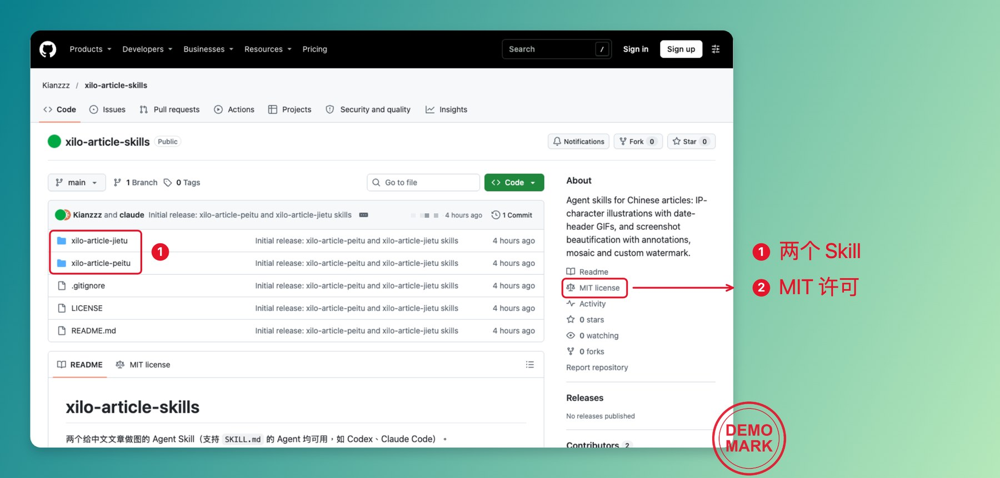

# xilo-article-skills

三个给中文文章做图的 Agent Skill（支持 `SKILL.md` 的 Agent 均可用，如 Codex、Claude Code）。

| Skill | 做什么 |
|---|---|
| [xilo-article-peitu](xilo-article-peitu/) | 用**你自己的 IP 角色**生成日期首图 GIF 与纯白手绘风正文配图，逐图审校后插入文章。**需自行提供 IP 角色**，首次运行时引导你登记。 |
| [xilo-article-jietu](xilo-article-jietu/) | 按文章上下文批量美化真实截图：标注、马赛克、渐变背景、可选自定义水印，本地网页编辑后一键回填文章。 |
| [xilo-article-cover](xilo-article-cover/) | 8 种封面风格的完整提示词与按需生图；默认橙围巾小水獭，也支持自定义 IP。支持公众号、X Articles 和视频封面。 |

## 封面提示词

先选风格，再确认标题，输出独立画幅的完整提示词；明确要求生成图片时才生图。包含纯白高透视破框、蜡笔主题剪贴、电商素材检查、纯白马赛克聚焦、深绿手绘、绿色对话框漫画、绿色复古掌机、绿色剪纸杂志。

默认角色为文字设定的小水獭，不附作者私人 IP 图或封面示例图；可提供自己的角色参考图。多图角色一致性仍需使用者确认。辅助尺寸检查与公众号组合预览需要 Python 3 + Pillow；只输出提示词不需要这些依赖。

## 配图效果（演示 IP）


> 配图需自行提供 IP 角色；上图使用的是演示用角色。

## 截图美化效果



## 安装

把需要的目录复制到 Agent 的 skills 目录，例如：

```bash
cp -r xilo-article-peitu xilo-article-jietu xilo-article-cover ~/.codex/skills/    # 或 ~/.claude/skills/
```

## 许可

MIT。`xilo-article-peitu/assets/fonts/WenKai.ttf`（霞鹜文楷）按 SIL OFL 1.1 随附。
