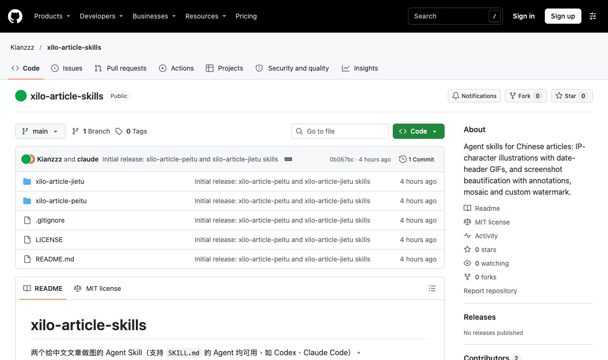
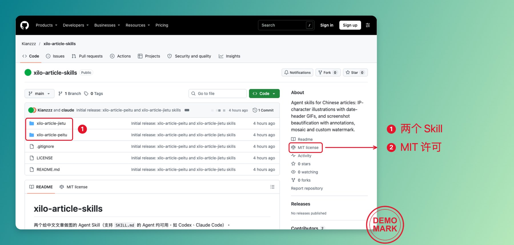
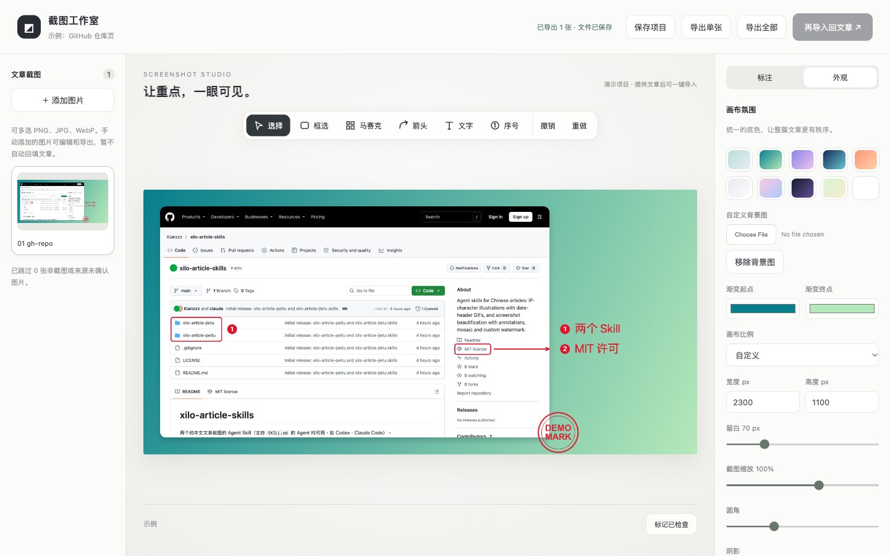

# xilo-article-jietu

文章截图批量美化 Agent Skill：读文章上下文 → 给每张真实截图预标注（框选、箭头、文字、序号）→ 打开本地网页编辑器微调背景、尺寸、标注、马赛克 → 导出 PNG/ZIP → 一键回填 Markdown / Obsidian 文章。

- 只处理真实截图，AI 生成图自动跳过
- 马赛克打码只作用于截图像素，标注保持清晰
- 编辑器只监听 `127.0.0.1`，截图不上传
- 纯 Python 标准库，无需安装依赖

## 效果示例

| 原始截图 | 处理后（序号标注 + 马赛克打码 + 渐变背景 + 演示水印） |
|---|---|
|  |  |

本地网页编辑器：左侧切换截图，中间直接拖动标注，右侧调整背景、尺寸和水印。



## 水印

不内置任何品牌水印。第一次运行时 Agent 会问你要不要加自己的水印，提供图片后保存为默认水印；跳过则默认关闭。

```bash
python3 scripts/editor.py watermark                 # 查看当前默认水印
python3 scripts/editor.py watermark --set logo.png  # 设置/更换（旧文件自动备份）
python3 scripts/editor.py watermark --clear         # 移除
```

默认水印存放在 `~/.config/xilo-article-jietu/`（可用 `XILO_ARTICLE_JIETU_CONFIG_DIR` 改位置）。网页编辑器里也能为单张截图上传临时水印，并“应用到全部”。

## 安装

把 `xilo-article-jietu/` 复制到你的 Agent skills 目录，例如 `~/.codex/skills/` 或 `~/.claude/skills/`。

测试：`cd scripts && python3 -m unittest test_editor`

## 许可

MIT
