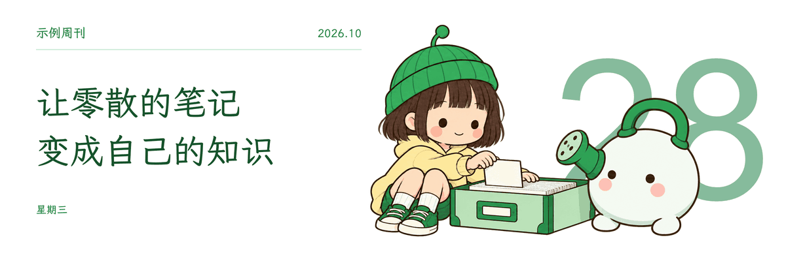
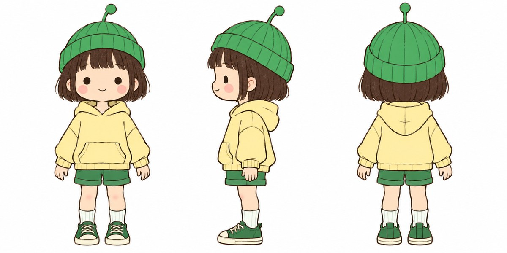
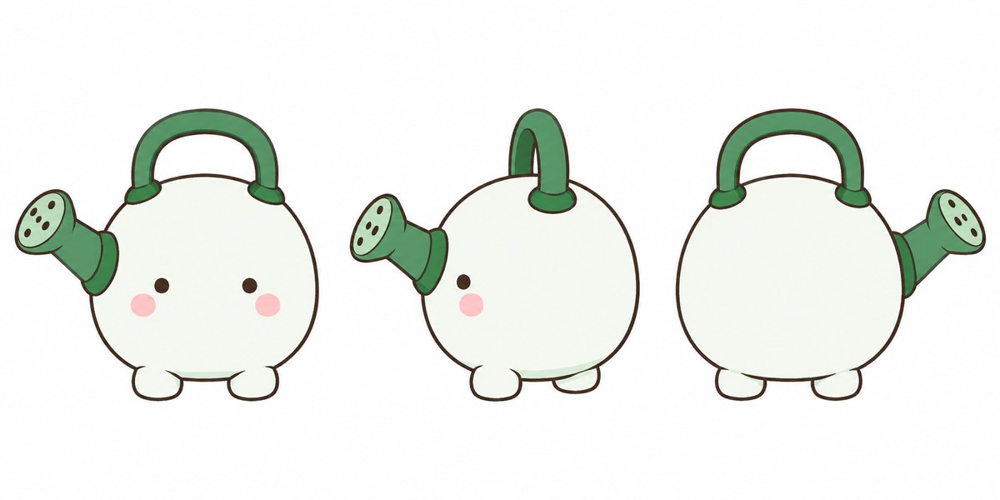

# xilo-article-peitu

> ⚠️ **需自行提供 IP 角色。** 本 Skill 不附带任何角色形象，首次运行时会请你上传自己角色的参考图（三视图最佳）并登记成档案；之后所有配图都用你的角色。没有现成 IP 的话，可以让 Agent 先帮你设计一个。

给中文文章自动规划、生成、审校并插入配图的 Agent Skill（Codex / Claude Code 等支持 `SKILL.md` 的 Agent 均可用）：

- **日期首图 GIF**：3:1 横版，日期 + 一句话金句 + 你的 IP 角色轻浮动，可加自己的印章
- **正文配图**：16:9 纯白纸面手绘风，“小人 + 超大装置”的物理隐喻，3–5 个中文短标注
- **目录图**：长文自动加横向阅读地图
- 逐图角色计数 / 比例 / 构图 QA，通过后才插入 Markdown 或 Obsidian 文章

## 效果示例

以下示例全部使用一套**演示用 IP**（戴天线绿帽的小孩 Pip 和喷壶伙伴 Spout），配一篇示例文章《用 AI 把一周的阅读笔记整理成知识卡片》生成。换成你的 IP 后，角色会变成你的角色。

**日期首图 GIF**（3:1，日期 + 一句话 + 角色轻浮动；README 中为压缩版）

**正文配图**（16:9，超大装置 + 迷你角色的物理隐喻）

| 让 AI 分拣：留下、合并、丢掉 | 每张卡片只回答一个问题 |
|---|---|
|  |  |

> 示例是一次限定每张图最多生成两次的真实运行结果，未经人工挑选或修图。按 Skill 自带的严格 QA，两张正文图的人物仍略偏大（约占画高 37%，规范上限 35%），实际使用时 Agent 会继续返工。

**首次运行时你需要提供的参考图**，类似这样（每个角色一张，三视图最佳）：

| 人物 | 伙伴 |
|---|---|
|  |  |

## 用你自己的 IP

Skill 不内置任何角色。第一次运行时它会请你提供：

1. 每个角色一张参考图（三视图最好，单张全身图也行），1–4 个角色
2. 每个角色一句话介绍（名字、人物还是伙伴、和谁搭档）
3. 可选：首图刊头文字、印章图片、色板、默认配图目录

Agent 会从参考图提炼出角色档案，给你确认后保存到 `~/.config/xilo-article-peitu/`（可用 `XILO_ARTICLE_PEITU_IP_DIR` 改位置）。之后每次配图都读取这份档案。没有现成 IP？可以让它先帮你设计一个。

## 依赖

- 一个能生成图片的工具（如 Codex 内置 `image_gen`）
- 首图合成：Python 3 + Pillow、FFmpeg、任意浏览器（用于加载字体排版）

## 安装

把 `xilo-article-peitu/` 复制到你的 Agent skills 目录，例如 `~/.codex/skills/` 或 `~/.claude/skills/`。

## 许可

代码与文档：MIT。`assets/fonts/WenKai.ttf` 为 [霞鹜文楷](https://github.com/lxgw/LxgwWenKai)，按 SIL Open Font License 1.1 随附（见 `WenKai-OFL.txt`）。
